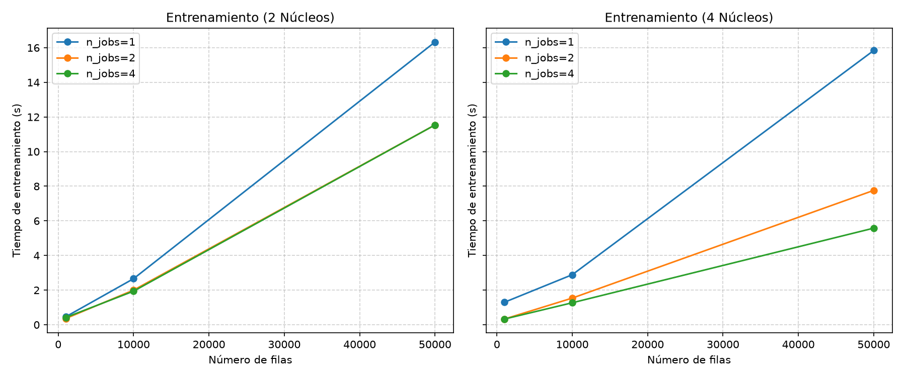

cat > docs/lab5/reporte_benchmark.md <<'EOF'
# Laboratorio 5 — Benchmark de Entrenamiento, Inferencia y Escalado (`ia_service`)

## 1. Tiempo de entrenamiento y aceleración

La aceleración se calcula como $\text{aceleración} = \frac{t(\text{n\_jobs} = 1)}{t(\text{n\_jobs} = k)}$:

| Máquina | Filas | $t$ (`n_jobs=1`) | $t$ (`n_jobs=2`) | Aceleración (`k=2`) | $t$ (`n_jobs=4`) | Aceleración (`k=4`) |
| :--- | :--- | :--- | :--- | :--- | :--- | :--- |
| **2 núcleos** | 1,000 | 0.46 s | 0.36 s | **1.28x** | 0.42 s | **1.10x** |
| **2 núcleos** | 10,000 | 2.66 s | 2.00 s | **1.33x** | 1.94 s | **1.37x** |
| **2 núcleos** | 50,000 | 16.33 s | 11.54 s | **1.42x** | 11.54 s | **1.42x** |
| **4 núcleos** | 1,000 | 1.30 s | 0.33 s | **3.94x** | 0.33 s | **3.94x** |
| **4 núcleos** | 10,000 | 2.89 s | 1.54 s | **1.88x** | 1.27 s | **2.28x** |
| **4 núcleos** | 50,000 | 15.84 s | 7.76 s | **2.04x** | 5.58 s | **2.84x** |

---

## 2. Gráfica de tiempo de entrenamiento vs. número de filas

---

## 3. Inferencia, tamaño del modelo y memoria del proceso

| Máquina | Filas | `n_jobs` | Lote 1,000 filas (s) | Latencia 1 fila (ms) | Tamaño modelo (MB) | Memoria proceso (MB) |
| :--- | :--- | :--- | :--- | :--- | :--- | :--- |
| **2 núcleos** | 1,000 | 1 | 0.039 | 19.5 | 13.8 | 181.4 |
| **2 núcleos** | 1,000 | 2 | 0.058 | 57.2 | 13.8 | 196.3 |
| **2 núcleos** | 1,000 | 4 | 0.068 | 57.0 | 13.8 | 204.9 |
| **2 núcleos** | 10,000 | 1 | 0.080 | 19.5 | 13.8 | 335.7 |
| **2 núcleos** | 10,000 | 2 | 0.068 | 56.0 | 13.8 | 347.1 |
| **2 núcleos** | 10,000 | 4 | 0.083 | 49.8 | 13.8 | 332.5 |
| **2 núcleos** | 50,000 | 1 | 0.150 | 22.7 | 631.4 | 859.2 |
| **2 núcleos** | 50,000 | 2 | 0.110 | 51.9 | 631.4 | 852.4 |
| **2 núcleos** | 50,000 | 4 | 0.102 | 54.0 | 631.4 | 850.0 |
| **4 núcleos** | 1,000 | 1 | 0.053 | 24.7 | 13.8 | 180.2 |
| **4 núcleos** | 1,000 | 2 | 0.069 | 55.8 | 13.8 | 189.0 |
| **4 núcleos** | 1,000 | 4 | 0.059 | 54.3 | 13.8 | 196.9 |
| **4 núcleos** | 10,000 | 1 | 0.081 | 21.3 | 137.6 | 329.4 |
| **4 núcleos** | 10,000 | 2 | 0.067 | 59.3 | 137.6 | 366.0 |
| **4 núcleos** | 10,000 | 4 | 0.069 | 55.3 | 137.6 | 353.1 |
| **4 núcleos** | 50,000 | 1 | 0.139 | 18.5 | 631.4 | 860.3 |
| **4 núcleos** | 50,000 | 2 | 0.086 | 46.7 | 631.4 | 849.5 |
| **4 núcleos** | 50,000 | 4 | 0.068 | 47.8 | 631.4 | 961.2 |

---

## 4. Construcción de la imagen (2 vs. 4 núcleos) y costo en cuota

| Configuración | RAM | Tiempo (`docker compose build --no-cache ia`) | Consumo de cuota Codespaces |
| :--- | :--- | :--- | :--- |
| **2 núcleos** | 8 GB | 67.47 s (`1m7.466s`) | 2 core-hours por hora real (1×) |
| **4 núcleos** | 16 GB | 46.86 s (`0m46.860s`) | 4 core-hours por hora real (2×) |

---

## 5. Conclusión

A partir de los resultados obtenidos en las pruebas con 2 y 4 núcleos, concluyo que pagar por más núcleos conviene únicamente cuando entrenamos con volúmenes grandes de datos (como 50,000 filas) o cuando ejecutamos construcciones pesadas de contenedores —donde la imagen pasó de 67.47 s a 46.86 s y el entrenamiento con `n_jobs=4` bajó de 15.84 s a 5.58 s (una aceleración de 2.84x)—; en cambio, en una máquina de 2 núcleos pasar de `n_jobs=2` a `n_jobs=4` no aporta mejora (ambos tardan 11.54 s) porque no hay núcleos físicos adicionales disponibles, y con datasets pequeños (1,000 filas) el costo de coordinar trabajadores incluso penaliza el tiempo. En inferencia, la latencia de una sola predicción empeora notablemente al usar `n_jobs > 1` (pasando de ~18.5–24.7 ms con `n_jobs=1` a ~46.7–59.3 ms con `n_jobs=2` o `4`) porque despachar y sincronizar procesos o hilos en `joblib` introduce una sobrecarga de comunicación mayor que el cálculo de una única fila. Por otro lado, al aumentar las filas de 1,000 a 50,000, el tamaño del modelo en disco crece de 13.8 MB a 631.4 MB y la memoria del proceso sube de ~180 MB hasta 961.2 MB. Para el contenedor de `IA-Service` en Kubernetes —que actualmente no tiene definido `resources.limits.memory`— esto representa un riesgo crítico: si el modelo crece o llegan varias peticiones concurrentes, el pod puede consumir toda la RAM disponible del nodo, degradar los demás microservicios o ser terminado abruptamente por el kernel mediante un *OOMKilled*. Finalmente, para entrenar modelos por lotes en producción elegiría una instancia optimizada para cómputo (o memoria si el dataset sigue creciendo) bajo un modelo de precio **spot** para reducir costos aprovechando que el entrenamiento tolera reintentos, mientras que para servir el microservicio de inferencia en tiempo real elegiría una instancia de **propósito general** con modelo **bajo demanda** o **reservada** (usando `n_jobs=1` para mantener baja latencia y límites de memoria definidos junto con el HPA).
EOF